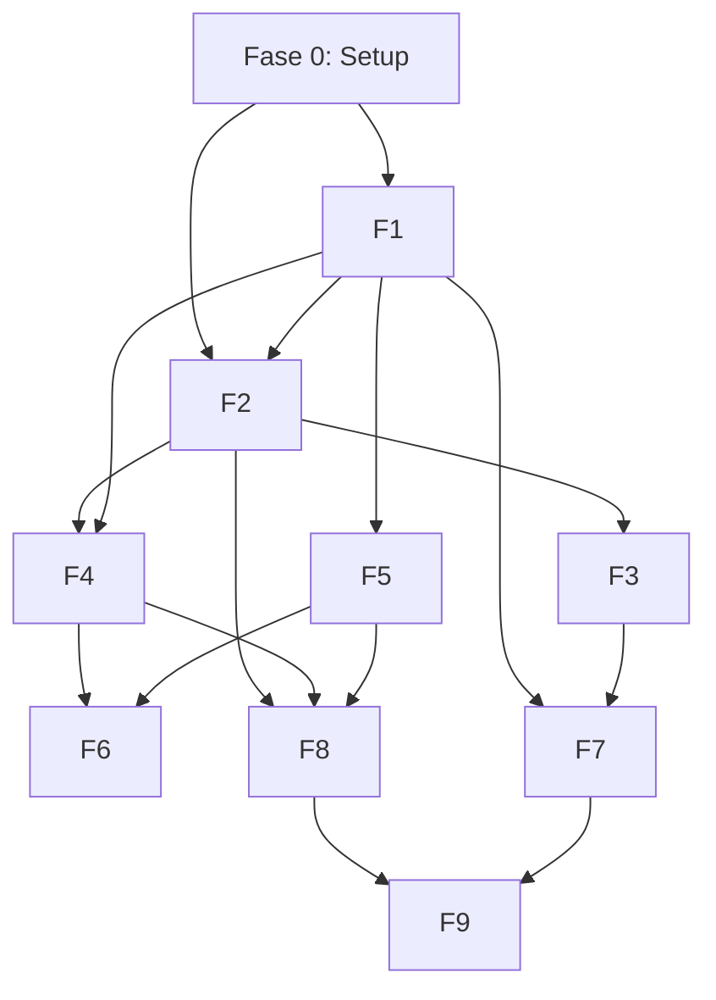

# Road map de desarrollo

## Filosofía

**Implementación vertical por funcionalidades completas.** Cada fase entrega
un feature end-to-end (diseño → código → tests → verificación). No se avanza
a la siguiente fase hasta que la actual pase todos sus criterios de aceptación.

**Base mínima funcional primero:** Backend + API + SQLite + MCP client. Luego
se itera hacia features de mayor valor.

## Fases de construcción

### Fase 0: Setup de entorno (Pre requisito)
**Estado:** ✅ Completada

| Tarea | Responsable | Status |
|-------|-------------|--------|
| Instalar Rust via rustup en asus-tuf | Agente | ✅ DONE |
| Instalar rustfmt + clippy | Agente | ✅ DONE |
| Instalar target musl | Agente | ✅ DONE |
| Verificar rustc/cargo funcionan | Agente | ✅ DONE |

**Entregable:** `rustc --version` y `cargo --version` funcionando en asus-tuf.

---

### Fase 1: Backend básico (Core API + SQLite)
**Estado:** ✅ Completada

**Objetivo:** API REST funcional con SQLite. Primeros endpoints. DB inicializada.

| Tarea | Criterio de aceptación | Status |
|-------|----------------------|--------|
| `cargo init` + Cargo.toml con dependencias | ✅ Compila |
| SQLite schema (notes, sessions, users, app_config) | ✅ `migrate` crea DB con 4 tablas |
| API `/health` | ✅ `curl localhost:8190/health` → `{"status":"healthy", ...}` |
| API `/api/config` | ✅ Devuelve config pública (sin secrets) |
| Session auth (cookies) | ✅ Request sin cookie → 302; con cookie → 200 |
| Rate limiting (60 req/min) | ✅ 61ª request → 429 |
| `cargo fmt --check` | ✅ Pass |
| `cargo clippy` | ✅ 0 errors |
| `cargo test` | ✅ 13 tests pasan |
| `cargo build --release` | ✅ 3.0 MB binary |
| glibc compatibility check | ✅ Max GLIBC_2.34 (remote tiene 2.43) |
| Build para musl | ❌ musl-gcc no disponible en asus-tuf |

**Notas:**
- FTS5 fue deshabilitado temporalmente en F1 — causaba "SQL logic error" al usar `content_rowid` con triggers. Replaneado para F5.
- musl static build no disponible (no musl-gcc en asus-tuf). Binary glibc verificado compatible con glibc 2.34+.
- Notes CRUD básico funciona (create, read, update, delete).
- Frontend: HTMX + Tailwind server-rendered, responsive (mobile + desktop).
- Login: Argon2 password hashing, UUID session tokens, HttpOnly + SameSite=Strict cookies.

---

### Fase 2: Cliente MCP (Mikareno)
**Estado:** 📋 Planeado

**Objetivo:** El backend puede conectarse al MCP de Mikareno via SSE e execute tools.

| Tarea | Criterio de aceptación |
|-------|----------------------|
| SSE client (connect, initialize, session) | POST `/mcp` → 200 + `mcp-session-id` |
| `tools/list` del MCP | 17 tools devueltos |
| `get_perfil` tool | Devuelve nombre, institución, curso |
| `get_calendario` tool | JSON con eventos |
| `get_horario` tool | Horario semanal |
| `get_notas_trimestre` tool | Notas por asignatura |
| Cache de 180s en SQLite | 2ª llamada usa cache (faster, no MCP call) |
| Error handling + retry | 3 reintentos con backoff, luego error 500 |
| Unit test: mock SSE server | `test_sse_handshake` + `test_tool_call` pasan |

**Dependencias:** Fase 1 (backend + DB)
**Nota:** MCP debe estar en remoto (127.0.0.1:8080). Si MCP sigue solo en local, usar Tailscale (`100.115.62.97:8080/mcp`) con un feature flag.

**Estimado:** 3-4 días

---

### Fase 3: Dashboard académico
**Estado:** 📋 Planeado

**Objetivo:** Interfaz web con calendario, horario y notas.

| Tarea | Criterio de aceptación |
|-------|----------------------|
| HTMX + Tailwind setup | HTML server-rendered |
| GET `/dashboard` | Muestra próximos eventos del calendario |
| GET `/dashboard/horario` | Horario por día de la semana |
| GET `/dashboard/notas` | Notas por asignatura, promedio calculado |
| GET `/dashboard/calendar.ics` | Export iCal (descargable) |
| Layout responsive | Mobile + desktop |
| `cargo test --test integration` | Dashboard tests pasan |

**Dependencias:** Fase 2 (MCP client)

**Estimado:** 4-5 días

---

### Fase 4: Asistente académico (OpenRouter)
**Estado:** 📋 Planeado

**Objetivo:** Chat con IA que usa contexto académico, en tiempo real (SSE streaming).

| Tarea | Criterio de aceptación |
|-------|----------------------|
| OpenRouter proxy (reqwest) | POST a openrouter.ai con model = `cohere/north-mini-code:free` |
| SSE streaming al frontend | Tokens llegan uno a uno via EventSource |
| Contexto por asignatura | POST `/api/chat/:subject` usa historial de esa asignatura |
| Token limit 16K | Si excede, resumen automático (LLM summary) |
| Cost tracking | `usage_metrics` table incrementa; alerta a $1.80 |
| No credential leakage | Prompt nunca incluye MIKARENO_USER/PASS |
| Unit test: prompt builder | `test_prompt_builder` verifica token count < 16K |

**Dependencias:** Fase 2 (MCP data) + Fase 3 (UI)
**Requiere:** OpenRouter API key configurada en `.env`

**Estimado:** 4-5 días

---

### Fase 5: Second Brain (notas Markdown)
**Estado:** 📋 Planeado

**Objetivo:** Crear, editar y buscar notas Markdown con formato Obsidian-compatible.

| Tarea | Criterio de aceptación |
|-------|----------------------|
| Markdown writer/reader | `pulldown-cmark` parse correcto |
| Obsidian wikilinks `[[...]]` | Parseados y enlazados |
| Frontmatter YAML | title, tags, created, updated |
| SQLite metadata + FTS5 | Search devuelve resultados < 500ms |
| CRUD notas | POST/GET/PUT/DELETE `/api/notes` |
| Import Obsidian dir | Read-only scan de `notes/` dir, indexa en SQLite |
| Unit test: markdown parse | `test_obsidian_compatible` pasa (roundtrip) |

**Dependencias:** Fase 1 (DB con FTS5)

**Estimado:** 3-4 días

---

### Fase 6: Material de estudio
**Estado:** 📋 Planeado

**Objetivo:** Generar resúmenes, cuestionarios y hojas de estudio vía OpenRouter.

| Tarea | Criterio de aceptación |
|-------|----------------------|
| Summary template | POST `/api/materials/summary` → Markdown con puntos clave |
| Quiz generator | POST `/api/materials/quiz` → JSON cuestionario (5 preguntas) |
| Study sheet | POST `/api/materials/study-sheet` → Markdown estructurado |
| Export PDF | Genera PDF desde Markdown (via GenOffice MCP) |
| Prompt templates | Predefinidos, con límites de salida (2048 tokens) |
| Test: content validation | Resumen no incluye datos sensibles ni credenciales |

**Dependencias:** Fase 4 (OpenRouter) + Fase 5 (notas)

**Estimado:** 2-3 días

---

### Fase 7: Suite de oficina web
**Estado:** 📋 Planeado

**Objetivo:** Generar/editar documentos via proxy al MCP de GenOffice (remoto port 8453).

| Tarea | Criterio de aceptación |
|-------|----------------------|
| GenOffice MCP client | SSE a `127.0.0.1:8453/mcp` funciona |
| Docx from Markdown | POST `/api/office/create-docx` → file descargable |
| PDF export | POST `/api/office/docx-to-pdf` → PDF generado |
| Xlsx from CSV | POST `/api/office/create-xlsx` → xlsx |
| Office status | GET `/api/office/status` → `{"available":true}` |
| Web UI | Formularios HTMX para generar documentos |

**Dependencias:** GenOffice MCP en remoto (ya disponible)

**Estimado:** 2-3 días

---

### Fase 8: MCP Server propio (rmcp)
**Estado:** 📋 Planeado

**Objetivo:** Exponer herramientas de la aplicación como MCP para clientes externos.

| Tarea | Criterio de aceptación |
|-------|----------------------|
| rmcp server (SSE, port 8081) | POST `/mcp` → 200 + session |
| `search_notes` tool | Busca FTS5, devuelve notas |
| `get_academic_context` tool | Devuelve horario + calendario cached |
| `create_study_sheet` tool | Llama a OpenRouter, devuelve Markdown |
| API key auth | Sin key → 401; con key → 200 |
| Test: external client | OpenCode remote puede listar + ejecutar tools |

**Dependencias:** Fases 2, 4, 5 (todos los módulos anteriores)

**Estimado:** 3-4 días

---

### Fase 9: Admin & Backup
**Estado:** 📋 Planeado

**Objetivo:** Dashboard de administración, backups y monitoreo.

| Tarea | Criterio de aceptación |
|-------|----------------------|
| GET `/admin/metrics` | CPU, RAM, disk, uptime |
| GET `/admin/openrouter/budget` | Cost tracking en vivo |
| POST `/admin/backup` | Crea backup SQLite |
| POST `/admin/backup/restore` | Restaura desde backup |
| Cron backup diario | `crontab` entry funciona |
| Backup test | Restore + verify data intacta |
| Systemd service | Auto-restart con MemoryMax=1G |

**Dependencias:** Todas las fases anteriores

**Estimado:** 2-3 días

---

## Matriz de dependencias

## Estado de los módulos

| Módulo | Fase | Status | Estado real (M12, 2026-10-11) |
|--------|------|--------|-------------------------------|
| Core API + SQLite | F1 | 📋 Por comenzar | ✅ Implementado y verificado (handlers, auth DB-backed, rate-limit; 289+ tests en árbol) |
| MCP Client (Mikareno) | F2 | 📋 Planeado | ✅ Implementado y verificado (`src/integrations/mikareno`, cache 180s; 14 tests mikareno_integration) |
| Dashboard académico | F3 | 📋 Planeado | ✅ Implementado y verificado (`src/academic`, 7 rutas `/dashboard/*`; 30 tests academic_integration) |
| Asistente OpenRouter | F4 | 📋 Planeado | ✅ Implementado y verificado (`src/ai`, `/api/ai/chat\|summary\|quiz\|study-sheet\|cost`; 27 tests ai_integration) |
| Second Brain (notes) | F5 | 📋 Planeado | ✅ Implementado y verificado (`src/knowledge` + `/app/notes`, `/api/notes`; 34 tests knowledge) |
| Material de estudio | F6 | 📋 Planeado | ✅ Implementado (dentro del módulo AI: summary/quiz/study-sheet mock mode) |
| Suite de oficina | F7 | 📋 Planeado | ✅ Implementado y verificado (`src/office`, `/office/*` filesystem-backed — NO es proxy GenOffice); 17 tests office_integration |
| Custom MCP Server | F8 | 📋 Planeado | ✅ Implementado y verificado (`src/mcp_server`, `POST /mcp`, `POST /mcp/sse`; 18 tests mcp_server_integration) |
| Admin & Backup | F9 | 📋 Planeado | ⚠️ Parcial (sin rutas `/admin/*`; backup solo procedural sqlite3+cron) |

> Nota M12: Session security hardened — `require_auth_state` valida contra DB SHA256(secret:token) lookup + legacy UUID fallback; rechaza sesiones expiradas via `Session::is_valid()`; logout elimina fila de DB. Nuevos tests M12: expiry, revocation after logout, missing-row fail-closed, valid-session acceptance. `cargo test`: ~300 tests (33 security + 9 ignored total); `fmt --check` PASS; `clippy` 0 errors; release build 7.0 MB GLIBC ≤2.38.

## Leyenda de estados

| Estado | Descripción |
|--------|-------------|
| 📋 Por comenzar | Planeado, no iniciado |
| ⏳ Pendiente | Bloqueado por aprobación externa |
| 🔨 En progreso | Implementación activa |
| ✅ Hecho | Implementado y verificado |
| ❌ Bloqueado | Obstruido por un impedimento |
