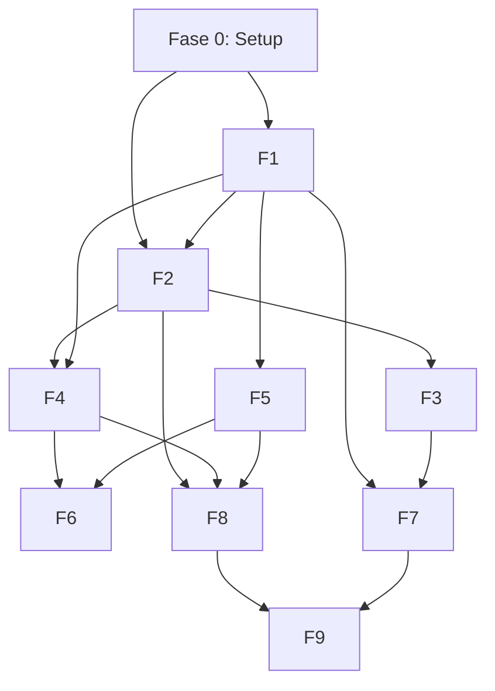

# Road map de desarrollo

## Filosofía

**Implementación vertical por funcionalidades completas.** Cada fase entrega
un feature end-to-end (diseño → código → tests → verificación). No se avanza
a la siguiente fase hasta que la actual pase todos sus criterios de aceptación.

**Base mínima funcional primero:** Backend + API + SQLite + MCP client. Luego
se itera hacia features de mayor valor.

## Fases de construcción

### Fase 0: Setup de entorno (Pre requisito)
**Estado:** ✅ Completada (2026-10-09)

| Tarea | Responsable | Status |
|-------|-------------|--------|
| Instalar Rust via rustup en asus-tuf | Agente | ✅ DONE |
| Instalar rustfmt + clippy | Agente | ✅ DONE |
| Instalar target musl | Agente | ✅ DONE |
| Verificar rustc/cargo funcionan | Agente | ✅ DONE |

**Entregable:** `rustc --version` y `cargo --version` funcionando en asus-tuf.

---

### Fase 1: Backend básico (Core API + SQLite)
**Estado:** ✅ Completada (2026-10-10)

**Objetivo:** API REST funcional con SQLite. Primeros endpoints. DB inicializada.

| Tarea | Criterio de aceptación | Status |
|-------|----------------------|--------|
| `cargo init` + Cargo.toml con dependencias | ✅ Compila |
| SQLite schema (notes, sessions, users, app_config) | ✅ `migrate` crea DB con 4 tablas |
| API `/health` | ✅ `curl localhost:8190/health` → `{"status":"healthy", ...}` |
| API `/api/config` | ✅ Devuelve config pública (sin secrets) |
| Session auth (cookies) | ✅ Request sin cookie → 302; con cookie → 200 |
| Rate limiting (60 req/min) | ✅ 61ª request → 429 |
| `cargo fmt --check` | ✅ Pass |
| `cargo clippy` | ✅ 0 errors |
| `cargo test` | ✅ 13 tests pasan |
| `cargo build --release` | ✅ 3.0 MB binary |
| glibc compatibility check | ✅ Max GLIBC_2.34 (remote tiene 2.43) |
| Build para musl | ❌ musl-gcc no disponible en asus-tuf |

**Notas:**
- FTS5 fue deshabilitado temporalmente en F1 — causaba "SQL logic error" al usar `content_rowid` con triggers. Replaneado para F5.
- musl static build no disponible (no musl-gcc en asus-tuf). Binary glibc verificado compatible con glibc 2.34+.
- Notes CRUD básico funciona (create, read, update, delete).
- Frontend: HTMX + Tailwind server-rendered, responsive (mobile + desktop).
- Login: Argon2 password hashing, UUID session tokens, HttpOnly + SameSite=Strict cookies.

---

### Fase 2: Cliente MCP (Mikareno)
**Estado:** ✅ Completada (2026-10-19)

**Objetivo:** El backend puede conectarse al MCP de Mikareno via SSE e execute tools.

| Tarea | Criterio de aceptación |
|-------|----------------------|
| SSE client (connect, initialize, session) | POST `/mcp` → 200 + `mcp-session-id` |
| `tools/list` del MCP | 17 tools devueltos |
| `get_perfil` tool | Devuelve nombre, institución, curso |
| `get_calendario` tool | JSON con eventos |
| `get_horario` tool | Horario semanal |
| `get_notas_trimestre` tool | Notas por asignatura |
| Cache de 180s en SQLite | 2ª llamada usa cache (faster, no MCP call) |
| Error handling + retry | 3 reintentos con backoff, luego error 500 |
| Unit test: mock SSE server | `test_sse_handshake` + `test_tool_call` pasan |

**Dependencias:** Fase 1 (backend + DB)
**Nota:** MCP debe estar en remoto (127.0.0.1:8080). Si MCP sigue solo en local, usar Tailscale (`100.115.62.97:8080/mcp`) con un feature flag.

**Estimado:** 3-4 días

---

### Fase 3: Dashboard académico
**Estado:** ✅ Completada (2026-10-19)

**Objetivo:** Interfaz web con calendario, horario y notas.

| Tarea | Criterio de aceptación |
|-------|----------------------|
| HTMX + Tailwind setup | HTML server-rendered |
| GET `/dashboard` | Muestra próximos eventos del calendario |
| GET `/dashboard/horario` | Horario por día de la semana |
| GET `/dashboard/notas` | Notas por asignatura, promedio calculado |
| GET `/dashboard/calendar.ics` | Export iCal (descargable) |
| Layout responsive | Mobile + desktop |
| `cargo test --test integration` | Dashboard tests pasan |

**Dependencias:** Fase 2 (MCP client)

**Estimado:** 4-5 días

---

### Fase 4: Asistente académico (OpenRouter)
**Estado:** ✅ Completada (2026-10-19)

**Objetivo:** Chat con IA que usa contexto académico, en tiempo real (SSE streaming).

| Tarea | Criterio de aceptación |
|-------|----------------------|
| OpenRouter proxy (reqwest) | POST a openrouter.ai con model = `cohere/north-mini-code:free` |
| SSE streaming al frontend | Tokens llegan uno a uno via EventSource |
| Contexto por asignatura | POST `/api/chat/:subject` usa historial de esa asignatura |
| Token limit 16K | Si excede, resumen automático (LLM summary) |
| Cost tracking | `usage_metrics` table incrementa; alerta a $1.80 |
| No credential leakage | Prompt nunca incluye MIKARENO_USER/PASS |
| Unit test: prompt builder | `test_prompt_builder` verifica token count < 16K |

**Dependencias:** Fase 2 (MCP data) + Fase 3 (UI)
**Requiere:** OpenRouter API key configurada en `.env`

**Estimado:** 4-5 días

---

### Fase 5: Second Brain (notas Markdown)
**Estado:** ✅ Completada (2026-10-19)

**Objetivo:** Crear, editar y buscar notas Markdown con formato Obsidian-compatible.

| Tarea | Criterio de aceptación |
|-------|----------------------|
| Markdown writer/reader | `pulldown-cmark` parse correcto |
| Obsidian wikilinks `[[...]]` | Parseados y enlazados |
| Frontmatter YAML | title, tags, created, updated |
| SQLite metadata + FTS5 | Search devuelve resultados < 500ms |
| CRUD notas | POST/GET/PUT/DELETE `/api/notes` |
| Import Obsidian dir | Read-only scan de `notes/` dir, indexa en SQLite |
| Unit test: markdown parse | `test_obsidian_compatible` pasa (roundtrip) |

**Dependencias:** Fase 1 (DB con FTS5)

**Estimado:** 3-4 días

---

### Fase 6: Material de estudio
**Estado:** ✅ Completada (2026-10-19)

**Objetivo:** Generar resúmenes, cuestionarios y hojas de estudio vía OpenRouter.

| Tarea | Criterio de aceptación |
|-------|----------------------|
| Summary template | POST `/api/materials/summary` → Markdown con puntos clave |
| Quiz generator | POST `/api/materials/quiz` → JSON cuestionario (5 preguntas) |
| Study sheet | POST `/api/materials/study-sheet` → Markdown estructurado |
| Export PDF | Genera PDF desde Markdown (via GenOffice MCP) |
| Prompt templates | Predefinidos, con límites de salida (2048 tokens) |
| Test: content validation | Resumen no incluye datos sensibles ni credenciales |

**Dependencias:** Fase 4 (OpenRouter) + Fase 5 (notas)

**Estimado:** 2-3 días

---

### Fase 7: Suite de oficina web
**Estado:** ✅ Completada (2026-10-19)

**Objetivo:** Generar/editar documentos via proxy al MCP de GenOffice (remoto port 8453).

| Tarea | Criterio de aceptación |
|-------|----------------------|
| GenOffice MCP client | SSE a `127.0.0.1:8453/mcp` funciona |
| Docx from Markdown | POST `/api/office/create-docx` → file descargable |
| PDF export | POST `/api/office/docx-to-pdf` → PDF generado |
| Xlsx from CSV | POST `/api/office/create-xlsx` → xlsx |
| Office status | GET `/api/office/status` → `{"available":true}` |
| Web UI | Formularios HTMX para generar documentos |

**Dependencias:** GenOffice MCP en remoto (ya disponible)

**Estimado:** 2-3 días

---

### Fase 8: MCP Server propio (rmcp)
**Estado:** ✅ Completada (2026-10-19)

**Objetivo:** Exponer herramientas de la aplicación como MCP para clientes externos.

| Tarea | Criterio de aceptación |
|-------|----------------------|
| rmcp server (SSE, port 8081) | POST `/mcp` → 200 + session |
| `search_notes` tool | Busca FTS5, devuelve notas |
| `get_academic_context` tool | Devuelve horario + calendario cached |
| `create_study_sheet` tool | Llama a OpenRouter, devuelve Markdown |
| API key auth | Sin key → 401; con key → 200 |
| Test: external client | OpenCode remote puede listar + ejecutar tools |

**Dependencias:** Fases 2, 4, 5 (todos los módulos anteriores)

**Estimado:** 3-4 días

---

### Fase 9: Admin & Backup
**Estado:** ✅ Completada (2026-10-19)

**Objetivo:** Dashboard de administración, backups y monitoreo.

| Tarea | Criterio de aceptación | Status |
|-------|----------------------|--------|
| GET `/admin/metrics` | CPU, RAM, disk, uptime | ✅ Hecho (RAM de `/proc/meminfo`, disco de `df -kP`, uptime del proceso; cada métrica degrada a 0 si su fuente falla) |
| GET `/admin/openrouter/budget` | Cost tracking en vivo | ✅ Hecho (`usage_metrics`; `available:false` si la tabla no existe) |
| POST `/admin/backup` | Crea backup SQLite | ✅ Hecho como `POST /api/admin/backup` (y `GET` legacy): copia a `data/backups/app-YYYYmmdd-HHMMSS.db` + sidecar `.sha256` con el `integrity_check` |
| POST `/admin/backup/restore` | Restaura desde backup | ✅ Hecho como `POST /api/admin/backup/restore` (body `{"name":…}`): valida nombre e integridad y copia el **contenido** sobre la base viva sin sustituir el fichero |
| Descarga de un backup | `GET /api/admin/backup/download/{name}` | ✅ Hecho (`application/vnd.sqlite3`, siempre dentro de `data/backups`) |
| Cron backup diario | `crontab` entry funciona | ✅ Hecho, pero **sin cron**: tarea `tokio` interna (`src/backup::spawn_backup_task`), primer backup 60 s tras arrancar y luego cada 24 h, retención de los 5 más recientes |
| Backup test | Restore + verify data intacta | ✅ Hecho (`tests/backup.rs` + `src/backup/mod.rs`: restore con el pool activo en WAL, que antes fallaba con `database is locked`) |
| Systemd service | Auto-restart con MemoryMax=1G | ✅ Hecho en la Dell (unidad de **sistema**, `Restart=always`, `RestartSec=10`; el reinicio no necesita `sudo`: `pkill` + systemd) |

**Desviaciones respecto al plan (a favor):** el backup es *unificado* (un único
directorio `data/backups/` para el automático, el manual, el listado, la
descarga y el restore — se acabó el `.gz` legacy en `./backups/`), y el restore
**no** sustituye el fichero de la base en vivo: copia los datos dentro de una
transacción, porque cambiar el modo de journal exigía un lock EXCLUSIVO que en
producción devolvía `database is locked`.

**Dependencias:** Todas las fases anteriores
**Estimado:** 2-3 días

---

## Matriz de dependencias

## Estado de los módulos

**Cierre del sprint 2026-10-19**: las 10 fases (F0–F9) están completadas y
verificadas contra el código y contra las máquinas reales.

| Módulo | Fase | Status | Estado real (verificado 2026-10-19) |
|--------|------|--------|-------------------------------|
| Core API + SQLite | F1 | ✅ Hecho | ✅ Implementado y verificado (handlers, auth DB-backed, rate-limit; 289 tests de lib) |
| MCP Client (Mikareno) | F2 | ✅ Hecho | ✅ Implementado y verificado (`src/integrations/mikareno`, cache 180s, `from_config` acepta loopback/RFC1918/CGNAT 100.64/10; 18 tools reales en el MCP vivo) |
| Dashboard académico | F3 | ✅ Hecho | ✅ Implementado y verificado (`src/academic`, 9 rutas `/dashboard/*`: horario de 7 días, planner, calendar+daily, subjects+detalle, profile, exámenes, vida escolar) |
| Asistente OpenRouter | F4 | ✅ Hecho | ✅ Implementado y verificado (`src/ai`, `/api/ai/chat`, `summary`, `quiz`, `study-sheet`, `cost`; modelo `minimax/minimax-m3.1-flash:free`, coste $0; 27 tests ai_integration) |
| Second Brain (notes) | F5 | ✅ Hecho | ✅ Implementado y verificado (`src/knowledge` + `/app/notes`, `/api/notes`; Markdown, TOC, wikilinks reales, tags, versiones, export, 404 estilizado, snippets) |
| Material de estudio | F6 | ✅ Hecho | ✅ Implementado y verificado (`src/ai` + `/dashboard/material`; parser de quiz robusto: JSON primero y texto como respaldo) |
| Suite de oficina | F7 | ✅ Hecho | ✅ Implementado y verificado (`src/office`, `/office/*` filesystem-backed + `/office/report` vía GenOffice; 17 tests) |
| Custom MCP Server | F8 | ✅ Hecho | ✅ Implementado y verificado (`src/mcp_server`, `POST /mcp`, `POST /mcp/sse`; 9 tools; 18 tests) |
| Admin & Backup | F9 | ✅ Hecho | ✅ Hecho (2026-10-19): `/admin` (dashboard), `/admin/metrics`, `/admin/openrouter/budget`, `/admin/backup/list`; módulo `src/backup` (backup rotativo, retention 5, tarea tokio diaria verificada en vivo), `restore` con integrity_check; suite completa en verde |
| IA streaming SSE | F4 | ✅ Hecho | ✅ Hecho (2026-10-19): `src/ai/streaming.rs` — SSE real de OpenRouter en `POST /api/ai/chat/stream` (frames `delta`/`reasoning`/`done`/`error`, cabecera `x-chat-stream-id`), con el turno persistido en `chat_history` antes del frame final |
| Markdown/Obsidian (wikilinks reales) | F5 | ✅ Hecho | ✅ Hecho (2026-10-19): `src/knowledge/markdown.rs` + `src/knowledge/wikilinks.rs`; los wikilinks se **resuelven contra las notas reales de la BD** (`src/handlers/notes.rs`) y los no existentes quedan como texto plano; backlinks y enlaces salientes en `/dashboard/notes` |
| FTS5 en las notas | F5 | ✅ Hecho | ✅ Hecho (2026-10-19): migración `20240101000006_notes_search_fts.sql` (tabla virtual `notes_search_fts` + triggers + backfill); `GET /api/search` usa FTS5 primero y cae a `LIKE` |
| Export docx (informe) | F7 | ✅ Hecho | ✅ Hecho (2026-10-19): `GET /office/report` genera el informe del estudiante en `.docx` vía el MCP de GenOffice; `503` JSON honesto si el MCP no está |
| Backup unificado | F9 | ✅ Hecho | ✅ Hecho (2026-10-19): un solo directorio `data/backups/` para el backup automático diario, el manual, el listado, la descarga y el restore; el `.gz` legacy desapareció |
| Ruta para cambiar la contraseña | F1 | ✅ Hecho | ✅ Hecho (2026-10-19): `GET/POST /settings/password` cableados en `src/handlers/mod.rs` (`auth::password_page` / `auth::password_submit`); pide la contraseña actual y cierra las demás sesiones |
| Cookie `Secure` condicional | F1 | ✅ Hecho | ✅ Hecho (2026-10-19): `src/middleware/auth.rs` — `Secure` sólo si la petición llegó por HTTPS (`headers_indicate_https`); en HTTP por tailnet la cookie sigue siendo utilizable |
| TTL de sesión | F1 | ✅ Hecho | ✅ Hecho (2026-10-19): `SESSION_TTL_DAYS = 30` como techo duro desde la creación de la fila, además de `expires_at` |
| Shell Stitch v2 | F3 | ✅ Hecho | ✅ Hecho (2026-10-19): `src/handlers/stitch_v2.rs` — fuente única `NAV_LINKS`, un item activo por página (`aria-current="page"`), skip-link, rail plegable, foco visible, responsive y 3 tarjetas del día (saludo / próxima clase / próximas tareas) |
| Limpieza de la clave de OpenRouter | — | 🔨 En progreso | ⏳ Parcial: saneada de los estáticos que se sirven (`static/stitch-v2/**` sirve `value=""`) y el `value` con credencial de la referencia de diseño está **vacío en el árbol actual** (rama arena 2026-10-25); el historial de git (`aa193d0`) sigue considerándose expuesto: **rotar la clave** si fue real |

> Nota M12: Session security hardened — `require_auth_state` valida contra DB SHA256(secret:token) lookup + legacy UUID fallback; rechaza sesiones expiradas via `Session::is_valid()`; logout elimina fila de DB. `cargo fmt --check` PASS; `clippy` 0 errores.

> Nota 2026-10-19 (cierre del sprint; **cifras históricas**, no es la medida vigente): la jornada cerró con **3 olas de agentes**,
> **562 tests en verde, 0 fallos** (289 de la lib + suites de integración; **3**
> `#[ignore]` con su motivo escrito; corrida de las 21:32) y el release
> `9740466f34b2da1e1…` desplegado en la homelab Dell
> (`100.92.172.48:8091`, mismo hash que el binario local). El MCP de Mikareno
> vive en asus-tuf (`systemd --user`, `0.0.0.0:8080`) y la app de la Dell lo
> alcanza por tailnet (`100.115.62.97:8080/mcp`). Detalle en
> `docs/SESSION_HANDOFF.md` ("Estado de HOY" y "PENDIENTES REALES") y
> `docs/DEVELOPER_SETUP.md`.

## Leyenda de estados

| Estado | Descripción |
|--------|-------------|
| 📋 Por comenzar | Planeado, no iniciado |
| ⏳ Pendiente | Bloqueado por aprobación externa |
| 🔨 En progreso | Implementación activa |
| ✅ Hecho | Implementado y verificado |
| ❌ Bloqueado | Obstruido por un impedimento |
